  

  

 

# KIRILL ALIEV

---

## 🎮 PLAYER PROFILE

<table>
<tr>
<td width="50%" valign="top">

<b>🎮 CLASS</b> 
Full-stack developer

  

<b>🗺️ DISTRICT</b> 
{{city / country}}

  

<b>⚡ PERK</b> 
UI that feels good to use

</td>
<td width="50%" valign="top">

<b>🔭 ACTIVE MISSIONS</b> 
MusicX · Photon

  

<b>🌱 TRAINING</b> 
{{what you are learning right now}}

  

<b>💡 FUN FACT</b> 
{{optional fun fact}}

</td>
</tr>
</table>

I build things for the web — from a CSS framework and browser-based apps to Node.js services with real databases.

---

## 🧰 LOADOUT

**PRIMARY // FRONTEND**

**SUPPORT // BACKEND**

**UTILITIES // TOOLS**

---

## 🎯 MISSIONS

<table>
<tr>
<td width="33%" valign="top">

MISSION 01 · ACTIVE

### 🎵 MusicX

> Your local soundtrack. No subscriptions.

Local music web service: search across **3 sources at once**, stream online, cache MP3 for offline listening, playlists, favorites and smart recommendations.

`Node.js` `Express` `SQLite` `Vanilla JS`

**[▶ START MISSION](https://github.com/alievkirill307-bot/music-X)**

</td>
<td width="33%" valign="top">

MISSION 02 · ACTIVE

### ✨ Photon

> Glass so clean it squeaks.

CSS framework in **Apple Liquid Glass** style: 40+ components, adaptive dark theme, CSS variables, **zero JS dependencies**, MIT license.

`CSS` `Design system` `Docs`

**[▶ START MISSION](https://github.com/alievkirill307-bot/Photon)** · **[LIVE DEMO](https://alievkirill307-bot.github.io/Photon/)**

</td>
<td width="33%" valign="top">

MISSION 03 · ACTIVE

### 🦊 lineFox

> What happens in the Gist stays in the Gist.

End-to-end encrypted chat in the browser: **AES-encrypted** messages stored in GitHub Gists, voice messages, file sharing, emoji reactions, 2 themes.

`JavaScript` `CryptoJS` `GitHub API`

**[▶ START MISSION](https://github.com/alievkirill307-bot/lineFox)**

</td>
</tr>
</table>

### 🛰️ SIDE MISSIONS

- 🛡️ [backend](https://github.com/alievkirill307-bot/backend) — auth demo: sessions, bcrypt password hashing, roles and admin panel on Node.js + Express + SQLite
- 📖 [photon-kit-docs](https://github.com/alievkirill307-bot/photon-kit-docs) — documentation site for the Photon kit
- 🏎️ [Racing-arcade](https://github.com/alievkirill307-bot/Racing-arcade) — HTML5 arcade racing game *(archived)*

---

## 📊 RAP SHEET

 

---

## 📻 CALL ME

 

**WORK EMAIL:** [alievkirill307@gmail.com](mailto:alievkirill307@gmail.com)  
**TELEGRAM:** [@VOVKAIT](https://t.me/VOVKAIT)

---

Fan-made GTA-inspired theme. Not affiliated with Rockstar Games.

